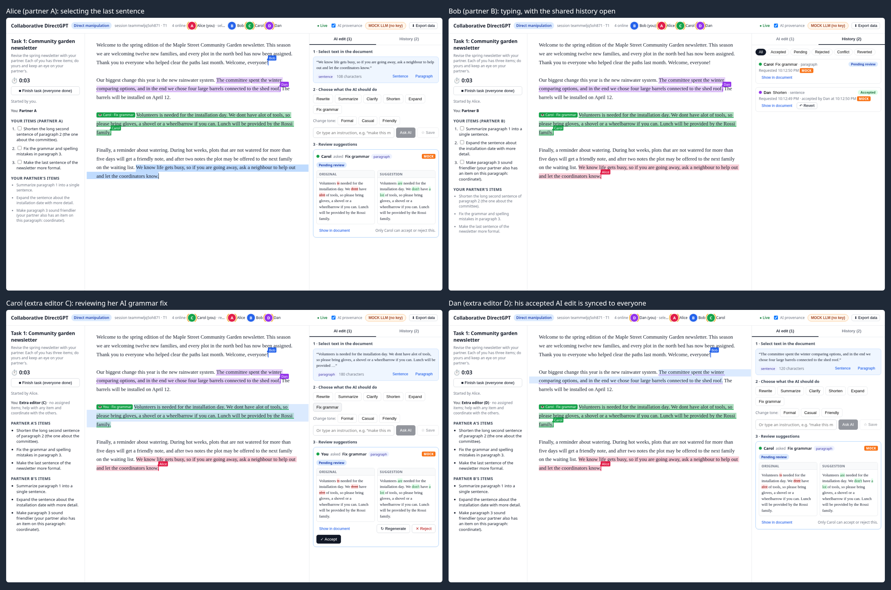
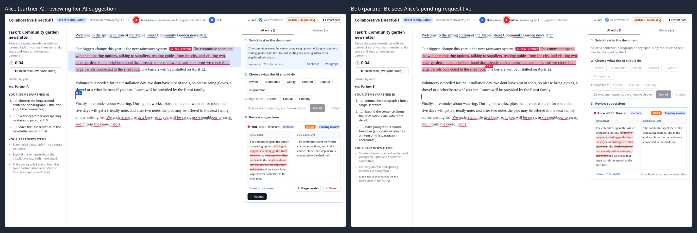
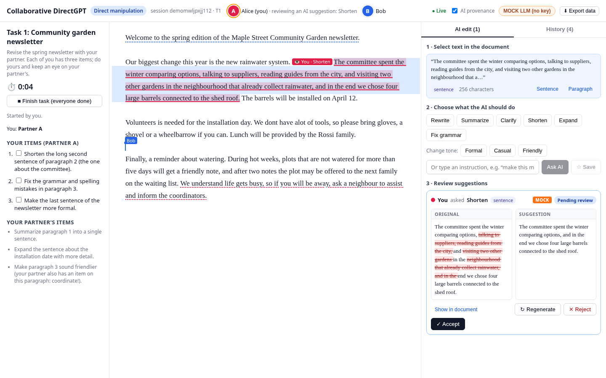
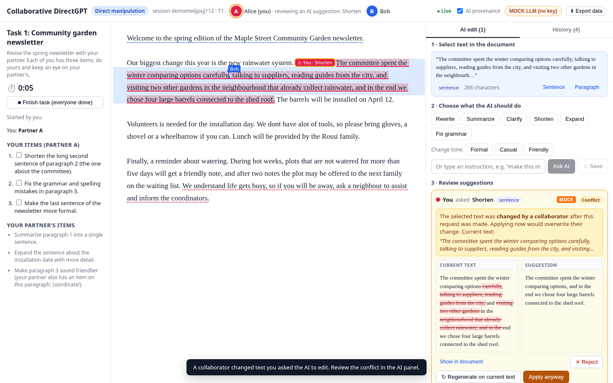
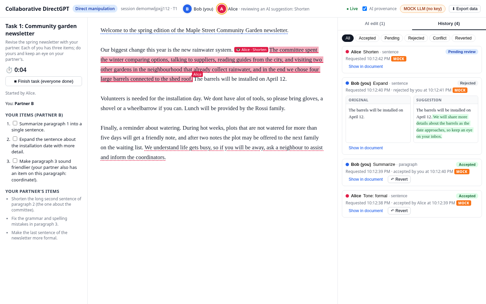
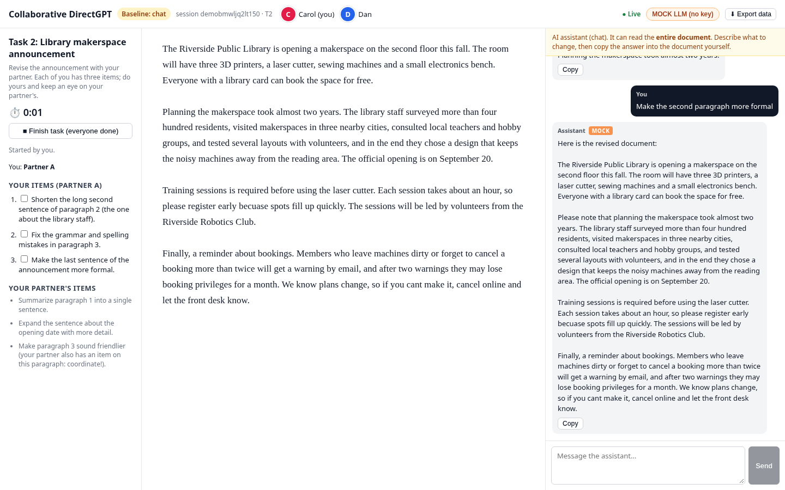
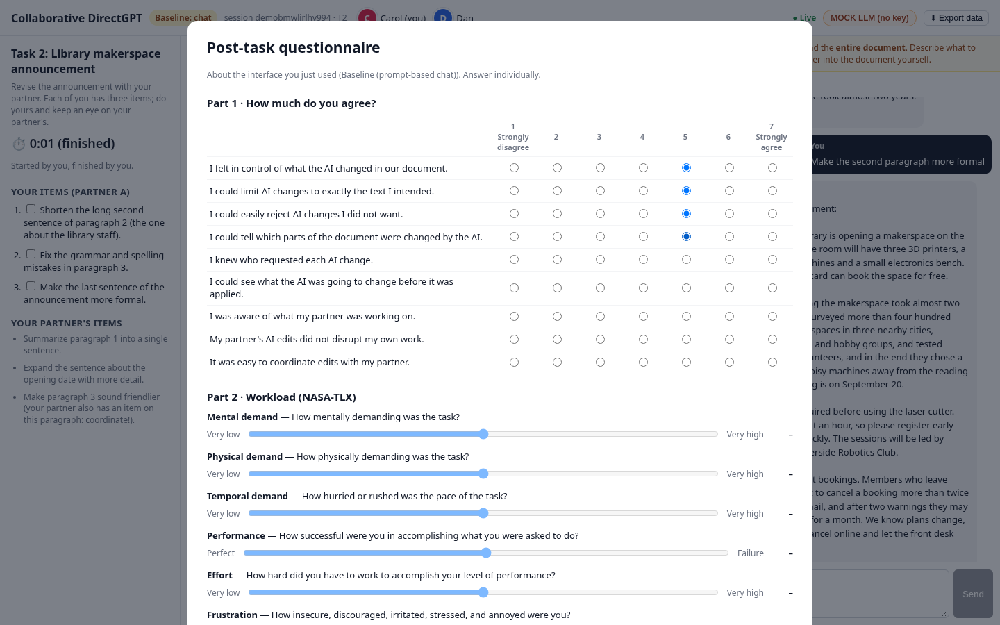

# Collaborative DirectGPT

**Direct manipulation for multi-user, AI-assisted document editing.**

Collaborative DirectGPT is a research prototype for the IFT 6077 (Human-AI Interaction) project
*"Collaborative DirectGPT: Direct Manipulation for Multi-User AI-Assisted Document Editing"* by
**Vishwa Anilkumar Kachhadiya** and **Shivam Mayurbhai Ardeshna** (Université de Montréal).

Any number of people (2, 5, 10 or more) edit one shared document in real time. To use the AI, a person **selects** the text to change,
picks a **command** (or types an instruction), **previews** the AI's suggestion as a diff, and **accepts or rejects** it.
Accepted edits sync to every collaborator and go into a shared **history**. The history records who requested each
edit, who approved it, and its status, and anyone can **revert** an edit from there. If a collaborator edits the
selected text while a suggestion is pending, the request is **flagged as a conflict**. The edit is then not applied
silently over the collaborator's work.

The project is a fork of, and builds on, **[DirectGPT](https://github.com/m-damien/DirectGPT)**
(Masson, Malacria, Casiez & Vogel, CHI 2024, [10.1145/3613904.3642462](https://doi.org/10.1145/3613904.3642462)).
The original single-user DirectGPT is kept intact and still runs from the launcher.


*Four collaborators in one session: partners A and B of the pair study plus two extra editors. Each person has their own colour, cursor and attribution.*

| Two collaborators, live | Preview before applying | Conflict protection |
|---|---|---|
|  |  |  |

| Shared history and attribution | Baseline: prompt-based chat | Post-task questionnaire |
|---|---|---|
|  |  |  |

---

## Contents

1. [Quick start](#quick-start)
2. [How this extends DirectGPT](#how-this-extends-directgpt)
3. [Architecture (mapped to Figure 1 of the proposal)](#architecture-mapped-to-figure-1-of-the-proposal)
4. [Using the app](#using-the-app)
   - [Any number of collaborators and join links](#any-number-of-collaborators-and-join-links)
5. [Running a study session](#running-a-study-session)
6. [Data export and analysis](#data-export-and-analysis)
7. [LLM providers: MOCK vs OpenAI](#llm-providers-mock-vs-openai)
8. [Tests](#tests)
9. [Project structure](#project-structure)
10. [Limitations](#limitations)
11. [Credits, citation and license](#credits-citation-and-license)

---

## Quick start

Requirements: **Node.js ≥ 20.19** (Node 22 LTS recommended) and npm.

```bash
npm install
npm run dev          # server on :1234 + Vite client on :5173 (hot reload)
```

Open **http://localhost:5173/#/collab**. To see the collaboration, open the invite link from the setup screen in as
many browser windows (or private windows, or other computers on the same network) as you like. Use the same *Session
ID*, task **Sandbox** and provider **MOCK**, and give each window a different display name.

Production-style single server (this is what the end-to-end tests use):

```bash
npm start            # type-check + build, then serve build/ and the API on http://localhost:1234
# open http://localhost:1234/#/collab
```

No API key is needed: the **MOCK** provider is deterministic, works offline and is clearly labelled in the UI.
To use a real model, see [LLM providers](#llm-providers-mock-vs-openai).

| Command | What it does |
|---|---|
| `npm run dev` | Development: collaboration/LLM server (tsx watch) + Vite dev client |
| `npm start` | Build, then run the production server on `PORT` (default 1234) |
| `npm run build` | Strict type-check of client, server and shared code, then `vite build` |
| `npm test` | Unit tests (Vitest) |
| `npm run test:e2e` | End-to-end tests (Playwright, 2 to 11 isolated browser contexts per test; builds and starts its own server on :4173) |
| `npm run test:all` | Both |
| `npm run screenshots` | Regenerate `docs/screenshots/*.png` |
| `npm run analyze` | Analyse study exports (see [analysis](#data-export-and-analysis)) |

The first time you run the e2e tests, install the browser with `npx playwright install chromium`.

---

## How this extends DirectGPT

DirectGPT showed that direct manipulation of visible objects is faster than conversational prompting, and that
people use fewer and shorter prompts with it: select an object, apply a reusable command, manipulate the output,
and undo. Collaborative DirectGPT applies these ideas to **shared** documents, which the proposal motivates with the
questions *which text is being changed, who asked, is it pending or accepted, and what happens when people act at
the same time?*

| DirectGPT (single user) | Collaborative DirectGPT (this fork) |
|---|---|
| Continuous representation of the object of interest (text editor) | Shared **CRDT document** (Yjs), live remote cursors and selections, presence bar showing what each collaborator is doing, for any number of collaborators |
| Select text, then prompt; the prompt is engineered with a `<blank>` placeholder | Same idea and the same prompt format (`shared/prompts.ts` adapts `TextPrompt.tsx`): only the selection is sent with a little surrounding context, so the AI cannot touch anything else |
| Toolbar of reusable commands; saving prompts as commands | Command toolbar (rewrite, summarize, clarify, shorten, expand, grammar, tone formal / casual / friendly), custom instructions, and **saved commands shared with the team** |
| Output replaces the selection immediately; undo to go back | AI output is a **suggestion**: inline **diff preview**, *accept / reject / regenerate* with version navigation. Only the requester decides |
| Local undo | Shared **history** with attribution (requester, decider, timestamps, provider) and **revert** for anyone, which is itself attributed |
| n/a | **Conflict detection**: each request is anchored with Yjs relative positions. If someone edits the anchored text before acceptance, the request is marked *conflicted*, shown to both users, and needs *Regenerate on current text* or an explicit *Apply anyway* |
| n/a | **Provenance highlighting** of AI-written text in the document, colour-coded by requester |
| ChatGPT baseline in the original study | **Baseline condition**: a private chat in which the model sees the whole document and the user copies and pastes the answer, which is the conventional prompt-based workflow the proposal compares against |
| Study harness for one participant | **Paired study harness**: session/condition/task setup, Latin-square counterbalancing, event logging, *unintended modifications* metric, Likert + NASA-TLX questionnaires, JSON/CSV export and an analysis script |

Changes to the original code: the build moved from the deprecated Create React App to **Vite** with strict TypeScript.
The app gained a `/collab` route and a link in the launcher. Everything else in `src/` (the DirectGPT text, code and
SVG editors and the original study) is unchanged and still works at `/#/`.

---

## Architecture (mapped to Figure 1 of the proposal)

```
 Browser (participant A)                 Node server (server/)                    Browser (participant B)
 ┌──────────────────────────┐          ┌───────────────────────────┐          ┌──────────────────────────┐
 │ CodeMirror 6 + y-codemirror│◀─ ws ──▶│ Yjs rooms (sync+awareness) │◀── ws ──▶│ CodeMirror 6 + y-codemirror│
 │ Direct panel / Chat panel  │  /yjs   │ persistence data/rooms     │   /yjs   │ History, presence, previews│
 │ Preview, History, Tasks    │         │ /api/llm  ─▶ MOCK or       │          │                            │
 └──────────────────────────┘ ─ http ─▶│   OpenAI-compatible API    │          └──────────────────────────┘
                                        │ /api/rooms/:room/export    │
                                        └───────────────────────────┘
```

All shared state is in **one Y.Doc per room** (`session.task.condition`): the document text, the AI request
records (a `Y.Map`), the event log, saved commands, session metadata and questionnaire answers. Every collaborator
therefore sees the same requests, statuses and history, with no extra server logic. The operations live in
`shared/ydoc.ts` and are covered by unit tests.

| # | Figure 1 step | Implementation |
|---|---|---|
| 1 | **Shared document**: collaborators edit one document in real time | `server/rooms.ts` (Yjs websocket rooms, server-side seeding of the task text, persistence), `src/collab/components/Editor.tsx` (CodeMirror 6 + `y-codemirror.next`, remote cursors), `PresenceBar.tsx` (who is online and what they are doing) |
| 2 | **Text selection**: the user selects a sentence, paragraph or span | `Editor.tsx` reports the selection; `DirectPanel.tsx` shows its scope with one-click *Sentence / Paragraph* expansion (`shared/scope.ts`); partners see the selection live |
| 3 | **AI edit request**: command or custom instruction, scoped to the selection | `DirectPanel.tsx` toolbar (`shared/commands.ts`), custom and saved commands; `createRequest()` stores the request with a **relative anchor** (`shared/anchors.ts`), the original text and the requester; an overlap warning appears if another pending request covers the same text |
| 4 | **LLM processing**: only the selection plus context is sent | `shared/prompts.ts` (DirectGPT `<blank>` prompt format, `cleanScopedResult`), `src/collab/llmClient.ts` → `server/llm.ts` (MOCK or OpenAI-compatible `/chat/completions`, timeouts, error classes) |
| 5 | **Preview**: the suggestion is shown beside the original | `PreviewCard.tsx` + `DiffView.tsx`: side-by-side word diff, version navigation, *Show in document*; the target is highlighted in the editor with the requester's label |
| 6 | **Approval**: the requester accepts, rejects or regenerates | `acceptRequest()` applies a **minimal character diff** inside the anchored range only (`shared/diff.ts`, `replaceRange`), so concurrent edits elsewhere are kept; `rejectRequest()`, `beginRegeneration()` |
| 7 | **Shared update**: the accepted edit syncs to all collaborators | Yjs transaction with origin `ai`; AI-written text gets provenance marks (`Editor.tsx`) on every client |
| 8 | **History and attribution** | `HistoryPanel.tsx`: requester, command, scope, timestamps, who decided, provider/model badge, status filters, diff, and **revert** (`revertRequest()`, attributed and protected by its own conflict check) |
| 9 | **Conflict check and feedback** | `refreshConflicts()` / `checkAnchor()` re-check every pending request after each document change (debounced). Changed or deleted anchored text gives the status *conflicted*, a toast for the requester, a banner showing the current text, and *Regenerate on current text* or *Apply anyway*. Every step is logged (`logEvent()`) for the measures in `shared/metrics.ts` |

**Baseline condition** (`ChatPanel.tsx`): a private chat. The model receives the **whole document** (`CHAT_SYSTEM_PROMPT`),
and the participant copies the answer and pastes it into the shared editor. Presence, cursors and the task panel are
the same in both conditions, so the experimental contrast is the editing workflow only.

Main design decisions:
- **One room per (session, task, condition).** The server seeds each room's text exactly once, which avoids duplicate seeding when two clients join at the same moment.
- **Any number of collaborators.** Nothing limits a room to two people. Each joiner is added to a shared roster in join order, which gives every person a distinct colour (8 hand-picked colours, then golden-angle hues), and all logic (presence, cursors, pending-request labels, history, conflicts, logging, export) is per participant. Roles A/B only decide which task items someone sees in the pair study.
- **Only the requester can accept or reject** a suggestion, which preserves individual decision authority as in the proposal. **Anyone can revert** an accepted edit, and the revert is attributed to them.
- To avoid races, the requester's client is the only one that writes a request's conflict status. Other clients compute the same check locally for display.
- The API key is **never stored**. A key typed in the UI is kept in memory for the tab and sent in a header for each request. A server key comes only from the environment.

---

## Using the app

1. Open `/#/collab` (or *New: Collaborative DirectGPT* in the original launcher).
2. Fill in **Session / pair ID**, **Participant ID** (a fresh one is suggested), **Display name** and, for study tasks, an optional **Study role**. Then choose the **condition**, the **task** and the **LLM provider**. *Copy link for partners (anyone)* copies an invite link that you can send to as many people as you like.
3. **Direct manipulation** condition:
   - Select text in the document. Optionally widen the selection to the sentence or paragraph.
   - Click a command, or type an instruction and click *Ask AI*. Click *Save* to share the instruction as a team command.
   - Review the diff. Then **Accept**, **Reject** or **Regenerate**, and use ‹ › to switch between versions.
   - The **History** tab lists every request and its status. **Revert** undoes an accepted edit.
   - If anyone else edits text you asked about, the card turns orange (*Conflict*). Choose *Regenerate on current text* (recommended) or *Apply anyway*.
4. **Baseline** condition: describe the change in the chat, click *Copy*, and paste the text into the document yourself.
5. The **AI provenance** toggle in the header shows or hides the highlighting of AI-written text. The header also has **Export data** and the LLM settings (click the provider badge).

### Any number of collaborators and join links

A session has no size limit: 2, 5 or 10+ people can join the same document. The end-to-end tests run sessions with 4, 5,
6 and 10 people.

**Join-link format** (everything after `#/collab?` is a normal query string):

```
http://<HOST>:<PORT>/#/collab?session=<id>&task=<task>&condition=<direct|baseline>&pid=<participant-id>&name=<display-name>[&role=<A-Z>][&provider=<mock|openai>][&model=<model>]
```

| Parameter | Required | Values |
|---|---|---|
| `session` | yes | Any id (letters, digits, `-`, `_`). Everyone with the same `session`, `task` and `condition` is in the same room. `pairNN` also selects the counterbalanced order |
| `task` | yes | `sandbox` (free editing, no roles), `practice`, `T1`, `T2`. Matching is case-insensitive, so `Sandbox` and `t1` also work |
| `condition` | yes | `direct` (Collaborative DirectGPT) or `baseline` (prompt-based chat) |
| `pid` | yes* | Participant id, unique per person, e.g. `P05` |
| `name` | yes* | Display name shown to the others |
| `role` | no | `A` / `B`: pair-study partners with their own items. `C`, `D`, …: extra editors who see all items. Omit it for no role. Ignored for `sandbox` |
| `provider` | no | `mock` (default) or `openai` |
| `model` | no | Model name for `openai` (default `gpt-4o`) |

\* If `pid` or `name` is missing, the link opens the setup screen with everything else filled in and a fresh suggested
participant id. That is how the shared **invite link** works: send one link to everyone, and each person types their
own name. If two people join with the same `pid`, both see a warning banner.

Examples:

```
# Invite link for everyone (each person enters their own name and id)
http://10.0.0.65:1234/#/collab?session=team01&task=sandbox&condition=direct&provider=mock

# Ready-made personal links
http://10.0.0.65:1234/#/collab?session=team01&task=sandbox&condition=direct&pid=P01&name=Shivam&provider=mock
http://10.0.0.65:1234/#/collab?session=team01&task=sandbox&condition=direct&pid=P02&name=Vishwa&provider=mock
http://10.0.0.65:1234/#/collab?session=team01&task=sandbox&condition=direct&pid=P03&name=Sam&provider=mock
```

**On a local network:** the server listens on all network interfaces (IPv4 and IPv6), and on startup it prints
`on your network: http://<LAN-IP>:1234/#/collab` for each address. Run `npm start` on one computer and have everyone
on the same Wi-Fi open the LAN address. They need nothing but a browser. `npm run dev` also exposes the dev client on
the network (port 5173). Set `HOST=127.0.0.1` to restrict the server to your own machine. Campus networks such as
eduroam often block connections between laptops; a home network or phone hotspot works.

**Who is online** is exactly who is connected to that room right now. The server ties each person's presence to their
connection: closing, reloading or leaving a tab (or the *Leave* button) removes them within a fraction of a second, and
a computer that crashes, sleeps or loses its network is dropped after about 5 seconds (2.5-second heartbeat). The
"who joined" list (used for colours and the export) is kept, but it is never shown as online. A new session from the
setup screen gets a fresh session id, so it never lands in an earlier session's room by accident.

**Roles in study tasks:** A and B have their own three items each (the pair protocol). Extra participants (role C, D, …
or no role) are labelled *Extra editor* and see every item, so they can help with any of them. In Sandbox there are no
roles or items.

---

## Running a study session

The full protocol (tasks, counterbalancing, measures, script and analysis plan) is in
**[docs/STUDY_PROTOCOL.md](docs/STUDY_PROTOCOL.md)**. In short:

1. On the study machine, run `npm start` so that one server hosts the app and stores the data in `data/`. Each partner uses their own computer or browser window and points it at the server.
2. For pair *n*, enter the session ID `pairNN` on the setup screen. The screen shows the **counterbalanced order** for that pair (a 4-order Latin square over condition × document).
3. Run the **Practice** task in each condition. The practice task has no questionnaire.
4. Run the two blocks in the order shown, for example *Direct on T1, then Baseline on T2*. In each block, one partner clicks **Start task**, both partners do their own three items, and then they click **Finish task**. Each participant then fills in the **questionnaire**: 9 Likert items on control, transparency and coordination, plus the raw NASA-TLX.
5. Click **Export data** in each room, or rely on the copy the server writes to `data/exports/` on every export.

The formal study uses **pairs** (roles A and B). Extra people can join a session, but they are not part of the
protocol, and `npm run analyze -- --pair-roles-only` restricts participant-level measures to A and B. The interface is
fully driven by URL parameters, so prepared links work as well (see the [join-link format](#any-number-of-collaborators-and-join-links)):

```
http://HOST:1234/#/collab?session=pair03&task=T1&condition=direct&role=A&pid=P05&name=Alice&provider=mock
```

## Data export and analysis

**Export data** (header) and the HTTP API provide the following for each room:

| Endpoint | Content |
|---|---|
| `GET /api/rooms` | List of rooms (live and persisted) |
| `GET /api/rooms/<room>/export?format=json` | Full export (`collab-directgpt/session-export@1`): metadata, initial and final text, every event, every AI request with all versions and decisions, questionnaires, computed summary |
| `…?format=events.csv` | One row per logged event (requests, responses, accepts, rejects, regenerations, conflicts, reverts, pastes, manual edits, chat messages, errors, …) |
| `…?format=summary.csv` | One row for the team and one per participant, with every measure |
| `…?format=questionnaires.csv` | One row per questionnaire, with item answers and construct scores |

Add `&download=1` to get a file download. Each JSON export is also saved to `data/exports/<room>.json`.

Measures computed automatically (`shared/metrics.ts`):
- task time
- number of prompts, typed prompt characters, and command vs typed prompts
- accepts, rejects, regenerations, conflicts and conflict overrides, reverts
- overlap warnings, copies and pastes, manually edited characters, AI errors, LLM latency
- **unintended modifications**: characters changed *outside* the task's target passages, from a diff of the final text against the initial text. **Intended changes** are counted inside the targets. This operationalises the proposal's "unintended modifications" measure in the same way for both conditions.

```bash
npm run analyze                          # all data/exports/*.json
npm run analyze -- exports/ other.json   # explicit files/folders
npm run analyze -- --demo                # SYNTHETIC demo data, to see the output format
```

The analysis script (`scripts/analyze.ts`, `shared/analysis.ts`) writes `comparisons.csv`, `team.csv`,
`participants.csv` and `report.md` to `data/analysis/`. For each measure and condition it reports the mean, SD and
median, followed by a **paired two-sided Wilcoxon signed-rank test** with the matched-pairs rank-biserial effect size.
The test is exact for small samples without ties; otherwise it uses a normal approximation with tie correction. It
was validated against R's `wilcox.test`. Team measures are paired by session and questionnaire measures by
participant within their session, so a participant ID reused in another pair is never merged with someone else. A room
exported more than once (for example the server copy and a downloaded copy) is counted once, using its most recent
export. `--demo` output is clearly labelled as synthetic and is **not** study data.

---

## LLM providers: MOCK vs OpenAI

| Provider | When to use | How |
|---|---|---|
| **MOCK** (default) | Development, demos, tests, offline pilots | Choose *MOCK* on the setup screen. Deterministic rule-based transforms (shorten, grammar fixes, tone, …) with simulated latency. It is **not a language model**, and every suggestion it produces carries an orange **MOCK** badge |
| **OpenAI-compatible** | Real sessions | Either set `OPENAI_API_KEY` for the server (see `.env.example`; a `.env` file is loaded automatically and is git-ignored), **or** paste a key in the app's *AI settings*. The key stays in tab memory and is never stored. `OPENAI_BASE_URL` and `OPENAI_MODEL` select any compatible endpoint and model (default `gpt-4o`) |

Errors are handled and shown to the user: a missing key, an invalid key, rate limits, provider errors, network
failures and timeouts all appear as a message in the panel, and the request is marked *failed*. Nothing is applied
to the document in these cases. The key is never written to logs, exports, the repository or the browser storage.

---

## Tests

```bash
npm test             # 102 unit tests (Vitest)
npm run test:e2e     # 11 end-to-end tests (Playwright, Chromium, 2 to 11 isolated browser contexts each)
```

- **Unit tests** (`tests/`) cover:
  - diffing and minimal edits; relative anchors and conflict checks
  - every request lifecycle transition, including late answers after cancellation, stale generations, forced accepts and reverts
  - scope detection; the prompt format and cleaning; the MOCK transforms
  - room naming and tasks; counterbalancing; metrics and the unintended-modification count; CSV/JSON export
  - the questionnaire scoring; the statistics (checked against R)
  - the LLM gateway (mocked `fetch`: success, auth, rate limit, timeout, network); the HTTP API and websocket rooms
  - multi-user: distinct colours for 50 people, roster join order agreed by all clients, roles and items, a 4-person room with a conflict between two extra editors, N-participant export and analysis
- **End-to-end tests** run each user in a separate browser context against the production build. `e2e/collab.spec.ts` (pairs):
  1. Full direct-manipulation flow: selection, request, preview, accept, sync to the partner, history attribution, revert, regenerate and versions, reject, custom and saved commands, export.
  2. Conflict: overlap warning, live conflict when the partner edits the text, regenerate on the current text, *Apply anyway*.
  3. Baseline: private chat, copy and paste with sync, finish task, questionnaires, CSV/JSON exports and file download.
  4. Graceful LLM errors: no key, unreachable provider, recovery.
  5. Setup screen, launcher link, and the original DirectGPT `/#/text` route.

  `e2e/multiuser.spec.ts` (more than two people):
  6. Four users (A, B, and extra editors C and D): presence and distinct colours for all, role-based items, live sync of typing, an AI edit by C that the others see pending and C accepts, synced to all four, attribution in everyone's history, a conflict between C and D resolved on the current text, and a 4-participant export.
  7. Five users in Sandbox (no roles), then a sixth who joins through the shared invite link (setup screen, fresh id, own name), plus the study-role options on the setup screen.
  8. Ten users typing at the same time end with identical text, and a reused participant id is flagged.

  `e2e/presence.spec.ts` (who is online):
  9. Closing a window removes that person from everyone's online list within 1.5 s; a reload never leaves a duplicate.
  10. A new session shows only the people connected to it, whether it is joined from a fresh page, after *Leave* in the same tab, or by changing the link in the address bar.
  11. The same checks with several tabs of one browser (which share storage).

  Every e2e test also fails if the browser logs any console error or uncaught exception.

---

## Project structure

```
shared/        Framework-independent core shared by client, server and tests
  ydoc.ts        Y.Doc schema and all request operations (create, suggest, accept, reject, regenerate, revert, conflicts)
  anchors.ts     Relative-position anchors and conflict checks
  diff.ts        Word/char diffs, minimal edits, inside/outside-target change counting
  prompts.ts     DirectGPT-style scoped prompt + whole-document chat prompt
  mockLLM.ts     Deterministic MOCK provider
  tasks.ts       Practice, T1, T2, Sandbox documents and per-role (A/B) task items
  roles.ts       Optional study roles (A/B pair, C+ extra editors, none)
  colors.ts      Distinct colours for any number of participants
  metrics.ts     Session/participant measures;  exportData.ts JSON/CSV export
  questionnaire.ts  Likert + NASA-TLX;  counterbalance.ts Latin square;  analysis.ts statistics
server/        Node server: Yjs websocket rooms, /api/llm gateway, export API, static hosting
src/collab/    React client for Collaborative DirectGPT (setup, workspace, panels, editor)
src/           Original DirectGPT (unchanged apart from the new route and launcher link)
scripts/       analyze.ts (+ demoData.ts synthetic generator)
tests/         Vitest unit tests;   e2e/  Playwright tests and screenshot generator
docs/          STUDY_PROTOCOL.md and screenshots
```

---

## Limitations

- **The MOCK provider is rule-based, not an LLM.** Its suggestions are plausible but simplistic. Use a real key for anything a participant will judge on quality.
- The OpenAI path is tested with a mocked `fetch`, covering request shape, success and every error class, and against an unreachable host. **Real model output needs a real API key to check.** The prompts follow DirectGPT's format, and the response cleaning strips the usual wrappers (quotes, "Here is…").
- Timestamps come from each participant's clock. With several machines, keep their clocks synced (NTP) so that cross-client latencies in the event log are meaningful. Task time uses a single start/end pair, so it is not affected.
- Sessions are tested with up to 10 simultaneous users (plus a duplicate-id joiner) on one machine. Larger groups should work, since Yjs is designed for this, but they have not been measured. With more than 3 people, the presence bar switches to a compact view (avatars and names; hover for activity).
- Only the person who requested an AI edit can accept or reject it. With many people that is deliberate (individual decision authority), but someone who leaves can strand a pending request. Others can still edit the text, which turns the request into a conflict, and the requester can resolve it when they return.
- *Finish task* asks for confirmation with the browser's native dialog.
- Rooms persist to local files, which suits a lab study. The server has no authentication, so do not expose it publicly.
- The original DirectGPT code still has some upstream npm-audit advisories in transitive dependencies (for example `picomatch` via build tooling) that have no non-breaking fix yet. They do not affect the runtime.

---

## Credits, citation and license

**DirectGPT** is by Damien Masson, Sylvain Malacria, Géry Casiez and Daniel Vogel. This fork keeps its full git
history and its MIT license (see [LICENSE](LICENSE)).

> Damien Masson, Sylvain Malacria, Géry Casiez, and Daniel Vogel. 2024. DirectGPT: A Direct Manipulation Interface
> to Interact with Large Language Models. In *Proceedings of the 2024 CHI Conference on Human Factors in Computing
> Systems (CHI '24)*. ACM. https://doi.org/10.1145/3613904.3642462

```bibtex
@inproceedings{masson2024directgpt,
  author    = {Masson, Damien and Malacria, Sylvain and Casiez, G\'{e}ry and Vogel, Daniel},
  title     = {DirectGPT: A Direct Manipulation Interface to Interact with Large Language Models},
  booktitle = {Proceedings of the 2024 CHI Conference on Human Factors in Computing Systems},
  series    = {CHI '24},
  year      = {2024},
  publisher = {ACM},
  doi       = {10.1145/3613904.3642462}
}

@misc{kachhadiya2026collabdirectgpt,
  author = {Kachhadiya, Vishwa Anilkumar and Ardeshna, Shivam Mayurbhai},
  title  = {Collaborative DirectGPT: Direct Manipulation for Multi-User AI-Assisted Document Editing},
  note   = {IFT 6077 course project, Universit\'{e} de Montr\'{e}al},
  year   = {2026}
}
```

The proposal also builds on Lehmann et al. (collaborative writing with AI agents) and Arnold and Kim (keeping
people involved in AI-assisted revision). See the proposal for the full references.

Collaborative DirectGPT additions © 2026 Vishwa Anilkumar Kachhadiya and Shivam Mayurbhai Ardeshna, released under
the same MIT license.

---

<details>
<summary>Original DirectGPT README</summary>

*Kept for reference. In this fork, the original DirectGPT runs with the commands in Quick start (`npm run dev`, then http://localhost:5173/#/) instead of on port 3000.*

# DirectGPT
### A user interface layer on top of ChatGPT that transforms direct manipulation actions to engineered prompts


__DirectGPT__ is a system that exemplifies how direct manipulation can be used to interact with large language models. The system includes a continuous representation of generated objects of interest; reuse of prompt syntax in a toolbar of commands; manipulable outputs to compose or control the effect of prompts; and undo mechanisms. For more details, see the [accompanying paper](https://arxiv.org/abs/2310.03691).

### [Online Demo](https://damienmasson.com/DirectGPT) / [How to build](#how-to-build-and-run) / [Publication (CHI'24)](#publication)

## How to build and run
The tool was created using TypeScript and React. To run it, you can use npm.
In the project directory, first install all dependencies:
```
npm install
```

Then run the project:
```
npm start
```

Once you started the server, go to this address to access the launcher: http://localhost:3000

## How to use?
After entering your OpenAI API key, you can test DirectGPT using the shortcuts or you can run the study.
Note that the system was tested and developped for recent versions of **Google Chrome** or **Mozilla Firefox**.


## How to get an OpenAI API key?
Because DirectGPT relies on the OpenAI API, you will need a key to make it work. You will need an account properly configured, see [here](https://platform.openai.com/account/api-keys) for more info.
Your key is never stored and the application runs locally and sends requests to the OpenAI API only. To give a rough estimation, running through the whole study is about 20 cents USD and most of the cost comes from the ChatGPT condition.


## Can I try without an API key?
The systen depends on the OpenAI API to work. If you enter an incorrect key, you will still be able to go through the study but executing prompts will yield an error.


## Where are the video tutorials?
From the launcher, you can start the study to see the exact ordering and video tutorials participants went through.
Alternatively, you can go in the ``build/static/tuto`` to review all the video tutorials.


## Publication
> Damien Masson, Sylvain Malacria, Géry Casiez, and Daniel Vogel. 2024. DirectGPT: A Direct Manipulation Interface to Interact with Large Language Models. In Proceedings of the 2024 CHI Conference on Human Factors in Computing Systems (CHI '24) [10.1145/3613904.3642462](https://doi.org/10.1145/3613904.3642462)

</details>
